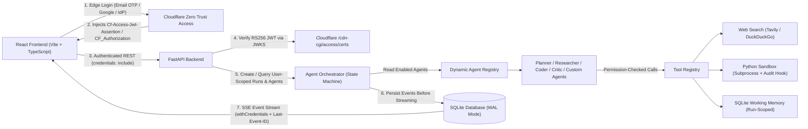
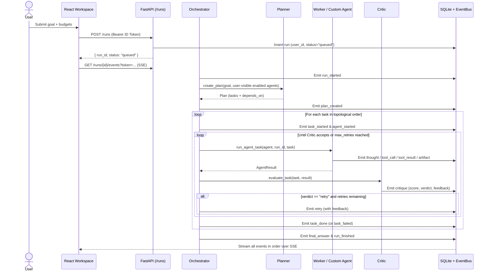

<div align="center">


# AGENTLENS

**Build your own AI agent teams. Watch them collaborate. Understand every execution.**


</div>

AgentLens is a **glass-box multi-agent AI platform** for creating, orchestrating, monitoring, and evaluating AI agent teams. Instead of hiding agent behavior behind a single black-box response, AgentLens persists every plan, decision summary, tool call, sandbox execution, critic verdict, retry, and token/cost metric as an ordered event stream in SQLite and streams it live to a React workspace over Server-Sent Events (SSE).

---

## Table of Contents

1. [Project Overview](#2-project-overview)
2. [Key Features](#3-key-features)
3. [Architecture](#4-architecture)
4. [Agent Architecture](#5-agent-architecture)
5. [Tech Stack](#6-tech-stack)
6. [Screenshots](#7-screenshots)
7. [Project Structure](#8-project-structure)
8. [Prerequisites](#9-prerequisites)
9. [Installation and Local Setup](#10-installation-and-local-setup)
10. [Cloudflare Access Setup](#11-cloudflare-access-setup)
11. [Environment Variables](#12-environment-variables)
12. [Usage Guide](#13-usage-guide)
13. [API Documentation](#14-api-documentation)
14. [Testing](#15-testing)
15. [Deployment](#16-deployment)
16. [Security](#17-security)
17. [Roadmap](#18-roadmap)
18. [Contributing](#19-contributing)
19. [License](#20-license)

---

## 2. Project Overview

### What AgentLens Is
AgentLens is a full-stack multi-agent orchestration and observability workbench built with **FastAPI**, **React 19**, **SQLite**, **Google Gemini**, and **Cloudflare Access**. Every execution ("run") is driven by a hand-written Python state machine that decomposes a user goal into dependent tasks, dispatches built-in and user-configured agents, evaluates outputs with a Critic, and records immutable events for live streaming and deterministic replay.

### What Problem It Solves
Most agent frameworks obscure *why* an agent chose a tool, *how* much a retry loop cost, or *where* a multi-step workflow failed. AgentLens treats observability and evaluation as first-class primitives:
- **No black-box orchestration:** There is no LangGraph or LangChain abstraction layer—every state transition is explicit, auditable Python (`backend/app/orchestrator.py`).
- **Event-sourced telemetry:** Dashboard metrics, live graphs, and historical replays are all derived from the same persisted `events` table rather than client-side estimates.
- **Multi-user isolation:** Authenticated Cloudflare Access users own their runs, custom agents, execution histories, and traces without cross-user leakage.

### How Users Interact with Multiple Agents
Users authenticate through Cloudflare Access (or local dev identity in development), submit a natural-language goal (optionally configuring step/token/time budgets or fault injection), and watch the **Planner** build a dependency graph of tasks assigned to **Researcher**, **Coder**, or custom agents. As tasks execute, the **Live Workspace** renders the interactive node graph (`@xyflow/react`), live activity timeline, story feed, and **Coder Live** sandbox output/plots in real time.

### How Custom Agents Extend the Platform
Users can build custom agents directly in the UI (**Build an Agent**) by configuring a name, role, system instructions, Gemini model, temperature, allowed tools (`web_search`, `python_sandbox`, `read_memory`, `write_memory`), JSON output schema, and execution limits (`max_steps`, `timeout_seconds`). Custom agents are stored in SQLite, scoped to the creator's authenticated `uid`, and immediately available to the Planner alongside built-in agents—without uploading arbitrary Python code.

---

## 3. Key Features

### Built-in Agents
- **Planner** — Decomposes goals into bounded sub-tasks with explicit `depends_on` edges, assigned agents, and measurable success criteria.
- **Researcher** — Queries web search (`Tavily` or `DuckDuckGo` fallback), stores findings in run-scoped memory, and synthesizes source-backed summaries.
- **Coder** — Generates Python code, runs it in the isolated subprocess sandbox, inspects `stdout`/`stderr`, captures Matplotlib plot artifacts, and self-corrects on failure.
- **Critic** — Evaluates each worker's output against the task's `success_criteria`, assigns a `0–10` score, and triggers bounded retries with actionable feedback.

### Custom Agent Builder
- **Create custom agents** with custom roles, descriptions, and system instructions.
- **Select supported models** from the server-enforced Gemini allowlist (`ALLOWED_MODELS`).
- **Assign tools** (`web_search`, `python_sandbox`, `read_memory`, `write_memory`) with server-side permission checks.
- **Configure execution limits** (`max_steps` 1–20, `timeout_seconds` 5–300) and JSON output schemas.
- **Enable, disable, duplicate, and test** custom agents in isolation (`POST /agents/{id}/test`).

### Orchestration
- **Dynamic agent registry** backed by SQLite (`AgentRegistry`), unifying built-in and custom agents under one `AgentDefinition` contract.
- **Task assignment & dependencies** resolved deterministically (Kahn-style topological ordering with deterministic cycle breaking).
- **Agent collaboration** via run-scoped shared working memory (`read_memory` / `write_memory`).
- **Critic evaluation & bounded retries** passing critique feedback back into subsequent attempts (`max_retries`).

### Observability
- **Live agent visualization** using `@xyflow/react` derived directly from persisted events.
- **Resumable SSE event streaming** (`GET /runs/{id}/events`) honoring `Last-Event-ID` and `last_event_id`.
- **Agent activity timeline & story feed** showing concise decision summaries (`thought`), tool calls, observations, and artifacts.
- **Tool-call monitoring** and **Coder Live** inspection of generated scripts, `stdout`, and base64-encoded Matplotlib charts.

### Evaluation
- **Token usage** (`in_tokens`, `out_tokens`, `total_tokens`) recorded per LLM call.
- **Estimated cost** (`cost_usd`) calculated from `backend/app/pricing.py` (overridable via `MODEL_PRICING_JSON`).
- **Latency** (`llm_latency_ms` and `wall_clock_seconds`).
- **Critic scores & retry counts** aggregated per run and per agent (`GET /runs/{id}/metrics`).
- **Execution budgets** tracked against guardrail limits (`max_steps`, `max_tokens`, `max_seconds`).

### Reliability
- **Code-enforced guardrails** (`GuardrailManager`) emitting `guardrail_warning` at 80% utilization and halting cleanly on `GuardrailExceeded`.
- **Fault injection** (`web_search` or `python_sandbox` modes: `empty`, `garbage`, `timeout`, `wrong_answer`) to test Critic/retry recovery.
- **LLM resilience** with JSON schema repair passes, exponential backoff retries, and model fallback (`MODEL_FALLBACK_MODELS`).
- **Offline simulation mode** when `GEMINI_API_KEY` is unset (`llm_mode: "offline_simulation"`), plus two pre-seeded recorded demo runs (`recorded_demo`).
- **Historical replay** scrubbing through persisted events step-by-step without re-invoking any LLM.

### Authentication & Data Isolation
- **Cloudflare Access (Zero Trust)** edge authentication with Email OTP, Google, GitHub, or configured IdP providers.
- **Backend RS256 JWT verification** (`PyJWT[crypto]`) validating `Cf-Access-Jwt-Assertion` / `CF_Authorization` against Cloudflare's JWKS endpoint (`/cdn-cgi/access/certs`).
- **Per-user data isolation** scoping runs, traces, metrics, custom agents, and agent execution histories to each authenticated user's `uid`.
- **Local development fallback** (`ALLOW_LOCAL_DEV_AUTH=true` in non-production environments) so developers can run locally without a Cloudflare Tunnel.
- **SQLite memory** (`memory` table keyed by `(run_id, key)`) and **full JSON trace export** (`GET /runs/{id}/trace`).

---

## 4. Architecture

### System Architecture



### Execution Flow



---

## 5. Agent Architecture

### Built-in Agents
| Agent ID | Role | Allowed Tools | Behavior |
|---|---|---|---|
| `planner` | Strategic Planning & Task Decomposition | None (system) | Generates 1–5 dependent `TaskDefinition` items assigned to enabled worker agents. |
| `researcher` | Information Gathering & Research | `web_search`, `read_memory`, `write_memory` | Searches the web, extracts key findings, writes summary to run memory, returns structured citations. |
| `coder` | Algorithm Engineering & Sandbox Execution | `python_sandbox`, `read_memory`, `write_memory` | Writes Python, executes it in the sandbox, repairs errors if needed, and captures stdout + plots. |
| `critic` | Quality Evaluation & Verification | None (system) | Scores task output (`0–10`) against `success_criteria` and directs bounded retries with feedback. |

Two pre-seeded custom template agents (`security_reviewer` and `fact_checker`) are also included as shared read-only templates (`user_id = "system"`). Users can run them directly or duplicate them into private custom agents.

### Shared Agent Contract & Execution Interface
Every agent—built-in or custom—is represented by `AgentDefinition` (`backend/app/agents/base.py`) and dispatched through a single function `run_agent_task()` (`backend/app/orchestrator.py`):
- **Input:** `TaskDefinition` (`id`, `title`, `description`, `assigned_agent_id`, `task_type`, `depends_on`, `success_criteria`, `expected_output`).
- **Output:** `AgentResult` (`agent_id`, `task_id`, `status`, `summary`, `structured_output`, `artifacts`, `usage`, `execution_duration`).
- **Dynamic Registration:** Custom agents created via `POST /agents` are validated (`validate_agent_definition()`), persisted to the `agents` SQLite table with `user_id = current_user.uid`, and dynamically included in `agent_registry.list_agents(enabled_only=True, user_id=self.user_id)` when the user starts a run.
- **Custom Execution:** `CustomAgentRunner` (`backend/app/agents/custom_agent.py`) dynamically compiles the agent's JSON `output_schema` into a Pydantic model, enforces `allowed_tools` via `tool_permitted()` on every tool call, and emits the exact same `Event` stream as built-in agents.

---

## 6. Tech Stack

| Layer | Technology | Version / Spec | Purpose |
|---|---|---|---|
| **Frontend Framework** | React + TypeScript | `react ^19.0.0`, `typescript ^5.7.3` | Component UI and type-safe state |
| **Build Tool** | Vite | `vite ^6.2.0` | Dev server with API proxy & production bundler |
| **Styling & Motion** | Tailwind CSS + Framer Motion | `tailwindcss ^3.4.17`, `framer-motion ^12.4.7` | Deep Charcoal / Warm Cream theme & transitions |
| **Graph Visualization** | React Flow (`@xyflow/react`) | `^12.4.2` | Live interactive agent dependency graph |
| **State Management** | Zustand | `^5.0.3` | App state (`useAppStore`) & auth state (`useAuthStore`) |
| **Icons** | Lucide React | `^1.16.0` | UI iconography |
| **Edge Authentication** | Cloudflare Access (Zero Trust) | `Cf-Access-Jwt-Assertion` / `CF_Authorization` | Edge identity & SSO authentication |
| **Backend Framework** | FastAPI + Uvicorn | `fastapi >=0.110.0`, `uvicorn >=0.28.0` | REST API, SSE streaming, lifespan management |
| **Validation** | Pydantic | `>=2.6.0` | Request/response schemas & dynamic LLM output models |
| **Backend JWT Verification** | PyJWT + Cryptography | `PyJWT[crypto] >=2.8.0` | RS256 Cloudflare Access JWT & JWKS verification |
| **LLM Provider** | Google Gemini API (via `httpx`) | `httpx >=0.27.0` | Structured JSON generation, repair, and model fallback |
| **Database** | SQLite (WAL mode) | Built-in Python `sqlite3` | Event-sourced `runs`, `events`, `agents`, `memory`, `meta` |
| **Code Sandbox** | Python Subprocess + Matplotlib | `matplotlib >=3.8.0` | Isolated code execution, audit hook, chart capture |
| **Web Search** | Tavily API / DuckDuckGo | `requests >=2.31.0` | Primary search with automatic DuckDuckGo fallback |
| **Testing** | Pytest + Pytest-Asyncio | `pytest >=8.0.0`, `pytest-asyncio >=0.23.0` | Backend unit, integration, scenario, and auth isolation tests |
| **Deployment** | Vercel (FE) + Render (BE) | `frontend/vercel.json`, `render.yaml` | Managed SPA hosting and persistent-disk API hosting |

---

## 7. Screenshots

> [!NOTE]
> Genuine AgentLens application screenshots have not yet been committed to this repository. Any non-application reference images in the workspace are intentionally excluded.

To add verified screenshots of your running AgentLens instance:
1. Start the backend and frontend locally, sign in, and open the **Dashboard**, **Live Workspace**, **Custom Agent Builder**, **Evaluations**, and **Replay** views.
2. Capture screenshots into `docs/screenshots/` (for example: `dashboard.png`, `live-workspace.png`, `agent-builder.png`, `evaluations.png`).
3. Embed them here using relative paths:
   ```markdown
   
   ```

---

## 8. Project Structure

```text
AgentLens/
├── .env.example                    # Backend environment template
├── pyrightconfig.json              # Pyright/Pylance path configuration
├── pytest.ini                      # Pytest configuration
├── render.yaml                     # Render deployment blueprint (Python 3.12.6 + 1 GB disk)
├── requirements.txt                # Python dependencies
├── DEMO_SCRIPT.md                  # Walkthrough script for live demos
├── PROJECT_PROGRESS.md             # Engineering progress log
├── backend/
│   ├── run_goal.py                 # CLI runner for executing a single goal from terminal
│   ├── app/
│   │   ├── main.py                 # FastAPI app, CORS, rate-limit middleware, /health, /config, /concepts, /auth/me
│   │   ├── auth.py                 # Cloudflare Access JWKS/JWT verification & local dev fallback
│   │   ├── config.py               # Environment-backed Settings and allowlists
│   │   ├── db.py                   # SQLite WAL connection manager & schema migrations
│   │   ├── events.py               # Event model, SSE serialization, EventBus pub/sub
│   │   ├── golden_runs.py          # Seeds two recorded_demo showcase runs
│   │   ├── guardrails.py           # Step, token, and wall-clock budget enforcement
│   │   ├── llm.py                  # Gemini HTTP client, JSON repair, retry/backoff, fallback, offline simulation
│   │   ├── middleware.py           # Per-IP rate limiting for POST /runs and POST /agents/{id}/test
│   │   ├── orchestrator.py         # Hand-written multi-agent state machine & run_agent_task()
│   │   ├── pricing.py              # Per-million-token cost table and estimator
│   │   ├── agents/
│   │   │   ├── base.py             # TaskDefinition, Plan, AgentResult, CriticEvaluation, AgentDefinition
│   │   │   ├── registry.py         # User-scoped SQLite AgentRegistry & validation
│   │   │   ├── planner.py          # Built-in Planner agent
│   │   │   ├── researcher.py       # Built-in Researcher agent
│   │   │   ├── coder.py            # Built-in Coder agent
│   │   │   ├── critic.py           # Built-in Critic agent
│   │   │   └── custom_agent.py     # Generic CustomAgentRunner for user-created agents
│   │   ├── routes/
│   │   │   ├── runs.py             # User-scoped /runs CRUD, SSE /events, /metrics, /trace
│   │   │   ├── agents.py           # User-scoped /agents CRUD, /duplicate, /toggle, /history, /test
│   │   │   └── tools.py            # Authenticated /tools metadata endpoints
│   │   └── tools/
│   │       ├── registry.py         # ToolDefinition metadata registry
│   │       ├── search.py           # Tavily + DuckDuckGo web search
│   │       ├── sandbox.py          # Subprocess Python sandbox with CPython audit hook & plot extraction
│   │       ├── memory.py           # Run-scoped SQLite working memory
│   │       └── faults.py           # Deterministic fault injection for reliability testing
│   └── tests/
│       ├── conftest.py             # Isolated temp DB, offline simulation, test environment setup
│       ├── test_api.py             # API, SSE, metrics, trace, validation, rate limit tests
│       ├── test_auth_isolation.py  # Cloudflare Access JWT enforcement & cross-user isolation tests
│       ├── test_agents.py          # Registry and built-in/custom agent contract tests
│       ├── test_llm.py             # LLM retry, JSON repair, fallback, and mode tests
│       ├── test_orchestrator.py    # End-to-end orchestration, dependency, retry, and guardrail tests
│       ├── test_pricing.py         # Token cost calculation tests
│       ├── test_scenarios.py       # Five end-to-end showcase scenario tests
│       └── test_tools.py           # Sandbox security, timeout, plot, search, and memory tests
└── frontend/
    ├── .env.example                # Frontend Vite & Cloudflare logout config template
    ├── index.html
    ├── package.json                # React 19, Vite 6, React Flow, Zustand
    ├── vercel.json                 # Vercel SPA build & rewrite config
    ├── vite.config.ts              # Dev server proxy (/runs, /agents, /tools, /health, /concepts, /config, /auth)
    └── src/
        ├── App.tsx                 # Auth-gated view router
        ├── api/client.ts           # Credentialed fetch wrapper & SSE URL builder
        ├── store/
        │   ├── useAppStore.ts      # Runs, events, agents, replay, theme state
        │   └── useAuthStore.ts     # Cloudflare Access session & logout state
        ├── components/
        │   ├── brand/              # AgentLensLogo geometric SVG mark & wordmark
        │   ├── layout/             # Navbar (auth profile + theme toggle), collapsible Sidebar
        │   ├── graph/              # CustomAgentNode for React Flow
        │   ├── ui/                 # Accessible InfoTooltip primitive
        │   ├── workspace/          # ActivityTimeline, AgentInspector, CoderLive, StoryFeed
        │   ├── NewRunModal.tsx     # Goal, budget, and fault-injection modal
        │   └── WhyModal.tsx        # Educational concept modal
        └── pages/
            ├── LandingPage.tsx
            ├── LearnPage.tsx       # Concepts, team roles & glossary
            ├── AuthPage.tsx        # Cloudflare Access session verification screen
            ├── DashboardPage.tsx   # Overview dashboard
            ├── LiveWorkspacePage.tsx
            ├── TemplatesPage.tsx   # Goal starters, cloneable agents & demo traces
            ├── AgentsPage.tsx
            ├── CustomAgentBuilderPage.tsx
            ├── EvaluationsPage.tsx
            ├── ReplayPage.tsx
            └── SettingsPage.tsx    # Account & Preferences
```

---

## 9. Prerequisites

- **Python:** 3.10 – 3.14 (Render deployment targets `3.12.6`)
- **Node.js:** 18+ (for Vite 6 and React 19)
- **npm:** 9+ (bundled with Node.js)
- **Cloudflare Zero Trust Account (for production):** Required to enforce Cloudflare Access edge authentication (local dev works out of the box with `ALLOW_LOCAL_DEV_AUTH=true`)
- **Gemini API Key (optional for local dev):** Obtain from [Google AI Studio](https://aistudio.google.com/apikey). If omitted, AgentLens runs in deterministic `offline_simulation` mode.
- **Tavily API Key (optional):** Enables Tavily web search; otherwise falls back to DuckDuckGo.

---

## 10. Installation and Local Setup

### 1. Clone the repository
```bash
git clone <your-repo-url> AgentLens
cd AgentLens
```

### 2. Backend environment setup
```bash
python -m venv .venv
# Linux / macOS:
source .venv/bin/activate
# Windows PowerShell:
.venv\Scripts\Activate.ps1

pip install -r requirements.txt
```

### 3. Configure environment variables
```bash
# Linux / macOS:
cp .env.example .env
cp frontend/.env.example frontend/.env

# Windows PowerShell:
Copy-Item .env.example .env
Copy-Item frontend/.env.example frontend/.env
```
Fill in `CLOUDFLARE_TEAM_DOMAIN` and `CLOUDFLARE_ACCESS_AUD` in `.env` for production Cloudflare Access (or keep `ALLOW_LOCAL_DEV_AUTH=true` for local development). Optionally add `GEMINI_API_KEY`.

### 4. Frontend dependencies
```bash
cd frontend
npm install
cd ..
```

### 5. Database initialization
No separate migration command is required. Starting the FastAPI server automatically runs `init_db()` (creating SQLite WAL tables and migrating schemas), seeds built-in/template agents, and seeds the two `recorded_demo` golden runs.

### 6. Start the backend and frontend
Terminal 1 (Backend on port `8000`):
```bash
uvicorn backend.app.main:app --reload --port 8000
```

Terminal 2 (Frontend on port `3000`):
```bash
cd frontend
npm run dev
```

Open `http://localhost:3000`. The Vite dev server proxies `/runs`, `/agents`, `/tools`, `/health`, `/concepts`, `/config`, and `/auth` to `http://127.0.0.1:8000`.

### Optional: CLI goal execution
Run a single goal directly from the terminal (bypasses HTTP/auth and runs the orchestrator locally):
```bash
python backend/run_goal.py "Benchmark three sorting algorithms on 10,000 items and explain the timings"
```
Add `--mock` to force offline simulation.

---

## 11. Cloudflare Access Setup

1. **Create a Cloudflare Zero Trust team:** Open the [Cloudflare Zero Trust Dashboard](https://one.dash.cloudflare.com/) and note your team domain (e.g., `https://myteam.cloudflareaccess.com`).
2. **Configure Identity Providers:**
   - Go to **Settings → Authentication → Login methods**.
   - Enable **One-time PIN** (Email OTP) and/or **Google**, **GitHub**, or **Okta**.
3. **Create an Access Application:**
   - Go to **Access → Applications → Add an application → Self-hosted**.
   - Set the application domain to your AgentLens domain (e.g., `agentlens.yourdomain.com`) and attach an Allow policy for your users.
   - Copy the **Application Audience (AUD) Tag** from the application's **Overview** tab.
4. **Configure Backend Environment:**
   - Set `CLOUDFLARE_TEAM_DOMAIN=https://<your-team>.cloudflareaccess.com`
   - Set `CLOUDFLARE_ACCESS_AUD=<your-application-aud-tag>`
   - Set `APP_ENV=production` (or `ALLOW_LOCAL_DEV_AUTH=false`) so requests without a valid `Cf-Access-Jwt-Assertion` or `CF_Authorization` JWT are rejected with `401`.

---

## 12. Environment Variables

### Backend (`.env`) — Private Server Configuration
| Variable | Default | Required | Description |
|---|---|---|---|
| `CLOUDFLARE_TEAM_DOMAIN` | — | Prod: Yes | Cloudflare Zero Trust team domain (e.g. `https://myteam.cloudflareaccess.com`). |
| `CLOUDFLARE_ACCESS_AUD` | — | Prod: Yes | Cloudflare Access Application Audience (AUD) tag. |
| `ALLOW_LOCAL_DEV_AUTH` | `true` in dev, `false` in prod | No | Uses a local dev identity when Cloudflare Access env vars are unset. |
| `LOCAL_DEV_USER_ID` | `local-dev-user` | No | Default `uid` when `ALLOW_LOCAL_DEV_AUTH=true`. |
| `LOCAL_DEV_USER_EMAIL` | `developer@localhost` | No | Default email when `ALLOW_LOCAL_DEV_AUTH=true`. |
| `GEMINI_API_KEY` | — | Optional | Google AI Studio API key. Empty = deterministic `offline_simulation`. |
| `TAVILY_API_KEY` | — | Optional | Tavily web search key. Empty = DuckDuckGo fallback. |
| `DEFAULT_MODEL` | `gemini-2.5-flash` | No | Default Gemini model when an agent omits one. |
| `ALLOWED_MODELS` | `gemini-2.5-flash,gemini-2.5-pro,gemini-3-flash-preview,gemini-3.5-flash,gemini-3.1-flash-lite` | No | Model allowlist enforced across built-in and custom agents. |
| `MODEL_FALLBACK_MODELS` | `gemini-3-flash-preview,gemini-3.1-flash-lite,gemini-3.5-flash` | No | Fallback models tried in order on `404`/`429`/`503`. |
| `ALLOW_OFFLINE_SIMULATION` | `true` | No | Enables offline simulation when `GEMINI_API_KEY` is unset. |
| `LLM_TIMEOUT_SECONDS` | `60` | No | Per-LLM HTTP request timeout. |
| `LLM_MAX_ATTEMPTS` | `3` | No | Retry attempts per LLM call. |
| `LLM_REPAIR_ATTEMPTS` | `1` | No | JSON repair attempts on malformed structured output. |
| `MODEL_PRICING_JSON` | — | Optional | JSON override for $/million-token pricing table. |
| `SEARCH_TIMEOUT_SECONDS` | `8` | No | Timeout for web search requests. |
| `DB_PATH` | `agentlens.db` | No | SQLite database path (use persistent disk path in production). |
| `APP_ENV` | `development` | No | Application environment label. |
| `CORS_ORIGINS` | `*` (`.env.example`: `http://localhost:3000,http://127.0.0.1:3000`) | Prod: Yes | Comma-separated allowed origins. Set exact frontend origin in production. |
| `RATE_LIMIT_REQUESTS` | `30` | No | Max `POST /runs` + `POST /agents/{id}/test` requests per window per IP. |
| `RATE_LIMIT_WINDOW_SECONDS` | `60` | No | Rate-limit window in seconds. |
| `SANDBOX_TIMEOUT_SECONDS` | `20` | No | Hard wall-clock timeout per Python sandbox execution. |
| `SANDBOX_MAX_OUTPUT_CHARS` | `10000` | No | Truncation cap for sandbox `stdout`/`stderr`. |
| `MAX_STEPS_DEFAULT` | `25` | No | Default step budget per run. |
| `MAX_TOKENS_DEFAULT` | `60000` | No | Default token budget per run. |
| `MAX_SECONDS_DEFAULT` | `300` | No | Default wall-clock budget per run. |
| `MAX_RETRIES_DEFAULT` | `2` | No | Default max Critic retries per task. |

### Frontend (`frontend/.env`) — Public Client Configuration
All `VITE_*` variables are bundled into the browser build and are **public** by design:

| Variable | Default | Required | Description |
|---|---|---|---|
| `VITE_API_URL` | `""` (empty) | Prod: Yes | Backend base URL (e.g., `https://agentlens-backend.onrender.com`). Leave empty locally to use Vite's proxy. |
| `VITE_CLOUDFLARE_LOGOUT_URL` | `/cdn-cgi/access/logout` | Optional | Cloudflare Access logout endpoint if frontend and backend are on different domains. |

---

## 13. Usage Guide

1. **Authenticate:** In production, Cloudflare Access authenticates you at the edge before loading the workspace; locally (`ALLOW_LOCAL_DEV_AUTH=true`), AgentLens signs you in as `local-dev-user`.
2. **Explore Recorded Demo Runs:** On **My Runs** (`DashboardPage`), two pre-seeded `recorded_demo` runs are available immediately to inspect the graph, timeline, and evaluations.
3. **Create & Configure Custom Agents:** Open **Build an Agent** (`CustomAgentBuilderPage`) to define a custom agent's name, role, instructions, model, temperature, allowed tools, JSON output schema, and execution limits. Use **Meet the Agents** (`AgentsPage`) to toggle, duplicate, test in isolation, or view per-agent execution history.
4. **Start a Run:** Click **Ask AgentLens** (`NewRunModal`), enter a goal, adjust guardrail budgets or fault injection settings if desired, and launch.
5. **Monitor the Live Graph & Events:** Watch the **Watch Live** (`LiveWorkspacePage`) React Flow graph, activity timeline, story feed, and **Coder Live** sandbox output update in real time over SSE.
6. **Evaluate Results:** Open **Scores** (`EvaluationsPage`) to review computed token usage, cost estimates, latency, critic scores, retry counts, and per-agent breakdowns.
7. **Replay & Export Traces:** Open **Replay a Run** (`ReplayPage`) to scrub through historical events step-by-step, or download the complete JSON trace from `/runs/{id}/trace`.

---

## 14. API Documentation

All protected endpoints verify the Cloudflare Access JWT via `Cf-Access-Jwt-Assertion`, the `CF_Authorization` cookie (sent automatically by browsers with `credentials: "include"`), `Authorization: Bearer <JWT>`, or `?token=<JWT>`.

| Method | Endpoint | Auth | Purpose | Key Parameters |
|---|---|---|---|---|
| `GET` | `/health` | Public | Liveness & LLM mode status | — |
| `GET` | `/config` | Public | Non-secret config, auth status, limits, pricing | — |
| `GET` | `/concepts` | Public | Educational AI concepts list | — |
| `GET` | `/auth/me` | Cloudflare JWT / Dev | Returns verified user (`uid`, `email`, `name`, `auth_provider`) | — |
| `POST` | `/runs` | Bearer | Create & start a run (rate-limited) | JSON: `goal`, optional `config`, `fault_injection` |
| `GET` | `/runs` | Bearer | List authenticated user's runs + public demo runs | Query: `limit` (1–500) |
| `GET` | `/runs/{run_id}` | Bearer | Get run details & totals (owner or public demo only) | Path: `run_id` |
| `GET` | `/runs/{run_id}/events` | Bearer or `?token=` | Resumable SSE event stream | Header `Last-Event-ID` or query `last_event_id` |
| `GET` | `/runs/{run_id}/metrics` | Bearer | Event-derived tokens, cost, latency, critic scores, per-agent stats | Path: `run_id` |
| `GET` | `/runs/{run_id}/trace` | Bearer | Full JSON trace export (no secrets) | Path: `run_id` |
| `GET` | `/agents` | Bearer | List system agents + user's custom agents | Query: `agent_type`, `enabled_only` |
| `GET` | `/agents/{agent_id}` | Bearer | Get single agent definition | Path: `agent_id` |
| `POST` | `/agents` | Bearer | Create a user-owned custom agent | JSON: `name`, `description`, `role`, `instructions`, `llm_config`, `allowed_tools`, `output_schema`, `execution_limits`, `enabled` |
| `PUT` | `/agents/{agent_id}` | Bearer | Update user-owned custom agent (`403` for system/template) | Path: `agent_id`, partial update JSON |
| `DELETE` | `/agents/{agent_id}` | Bearer | Delete user-owned custom agent (`400` built-in, `403` template) | Path: `agent_id` |
| `POST` | `/agents/{agent_id}/duplicate` | Bearer | Clone any visible agent into a user-owned custom agent | Path: `agent_id` |
| `POST` | `/agents/{agent_id}/toggle` | Bearer | Toggle user-owned custom agent enabled state | Path: `agent_id` |
| `GET` | `/agents/{agent_id}/history` | Bearer | Agent's execution history scoped to user's runs + public demos | Query: `limit` (1–50) |
| `POST` | `/agents/{agent_id}/test` | Bearer | Isolated single-agent test (rate-limited) | JSON: `test_prompt` |
| `GET` | `/tools` | Bearer | List registered tool metadata | — |
| `GET` | `/tools/{tool_name}` | Bearer | Get metadata for a specific tool | Path: `tool_name` |

### Example Authenticated Request
```bash
curl -X POST https://your-domain.com/runs \
  -H "Cf-Access-Jwt-Assertion: <CLOUDFLARE_ACCESS_JWT>" \
  -H "Content-Type: application/json" \
  -d '{"goal": "Compare quicksort and mergesort on 5,000 integers"}'
```

---

## 15. Testing

### Backend Unit, Integration, Scenario & Auth Isolation Tests
```bash
python -m pytest backend/tests -q
```
The test suite (`backend/tests/conftest.py`) isolates state into a temporary SQLite database, clears `GEMINI_API_KEY` to enforce offline simulation, disables rate limiting, and tests:
- `test_auth_isolation.py` — `401` enforcement on unauthenticated/invalid/expired tokens, `?token=` SSE auth, and strict cross-user isolation for runs, metrics, traces, SSE streams, and custom agents.
- `test_api.py` — API validation, SSE history/resume, trace-to-metrics consistency, agent CRUD, and rate-limit middleware.
- `test_orchestrator.py` & `test_scenarios.py` — Dependency ordering, retries, guardrails, fault recovery, and 5 showcase scenarios.
- `test_llm.py`, `test_agents.py`, `test_tools.py`, `test_pricing.py` — LLM repair/fallback, sandbox audit hook/timeout/plot capture, memory isolation, and pricing.

### Frontend Type-Check & Production Build
There is no frontend unit-test runner configured; frontend integrity is verified with TypeScript type-checking and Vite production bundling:
```bash
cd frontend
npm run build
```

---

## 16. Deployment

### Backend on Render
`render.yaml` configures a Python `3.12.6` web service with `/health` check and a 1 GB persistent disk at `/var/data` (`DB_PATH=/var/data/agentlens.db`):
1. Connect the repository in Render using `render.yaml`.
2. Set secret environment variables in the Render dashboard:
   - `CLOUDFLARE_TEAM_DOMAIN` (e.g. `https://myteam.cloudflareaccess.com`)
   - `CLOUDFLARE_ACCESS_AUD` (Application Audience tag)
   - `GEMINI_API_KEY` (and optionally `TAVILY_API_KEY`)
   - `CORS_ORIGINS` set to your exact frontend origin (e.g., `https://agentlens.yourdomain.com`) — never leave `*` in production.
3. Keep `DB_PATH` on the persistent disk (`/var/data/agentlens.db`); without persistent storage, deploys and restarts erase SQLite runs and custom agents.

### Frontend on Vercel
`frontend/vercel.json` builds with `npm run build`, outputs `dist`, and rewrites SPA routes to `/index.html`:
1. Import the project in Vercel with **Root Directory** set to `frontend`.
2. Set `VITE_API_URL=https://<your-render-service>.onrender.com` in Vercel Environment Variables and place your domain behind Cloudflare Access.
3. Redeploy after changing any `VITE_*` variable so Vite bakes it into the bundle.

---

## 17. Security

- **Cloudflare Access JWT Verification:** Every protected REST and SSE route verifies the Cloudflare Access RS256 JWT (`Cf-Access-Jwt-Assertion`, `CF_Authorization`, `Authorization: Bearer`, or `?token=`) against Cloudflare's JWKS endpoint (`backend/app/auth.py`). Unauthenticated, invalid, wrong-audience, or expired tokens are rejected with `401`.
- **User-Level Resource Isolation:** `runs` and custom `agents` store `user_id`. Queries filter by `user_id = current_user.uid` (plus read-only `is_public = 1` golden demo runs and `user_id = 'system'` read-only built-in/template agents), returning `404` for another user's private resources and `403` when attempting to mutate shared system templates.
- **Tool Permissions:** `tool_permitted()` enforces `allowed_tools` server-side on every tool call.
- **Execution Guardrails:** `GuardrailManager` enforces `max_steps`, `max_tokens`, and `max_seconds` in code.
- **Python Sandbox Restrictions:** `backend/app/tools/sandbox.py` combines static pattern rejection, a throwaway working directory with a stripped environment, an in-child CPython `sys.addaudithook` blocking subprocess creation, sockets/network, and out-of-sandbox writes, POSIX `rlimits` (where supported), and a hard wall-clock timeout. *(Note: this is process isolation, not a VM/container boundary—use gVisor/Firecracker/Piston for untrusted multi-tenant code execution.)*
- **API Key Handling:** `GEMINI_API_KEY` and `TAVILY_API_KEY` remain strictly on the backend and are never exposed by `/config`, traces, logs, or the frontend bundle.

---

## 18. Roadmap

Planned future improvements (not included in the current release):
- Model Context Protocol (MCP) tool & server integration
- External agent connectivity / webhook-based remote agents
- Additional LLM providers beyond Google Gemini
- Expanded automated evaluation suites and regression benchmarks
- Parallel execution for independent DAG branches
- PostgreSQL storage backend and containerized/VM-isolated code sandboxing
- Automated frontend unit and E2E test suite

---

## 19. Contributing

Contributions are welcome:
1. Fork the repository and create a feature branch from `main`.
2. Make focused changes following existing backend (`backend/app/`) and frontend (`frontend/src/`) patterns.
3. Verify your changes before opening a pull request:
   ```bash
   python -m pytest backend/tests -q
   cd frontend && npm run build
   ```
4. Never commit `.env` files or SQLite databases.

---

## 20. License

No `LICENSE` file is currently present in this repository. All rights are reserved by the repository owner until an explicit license file is added.
