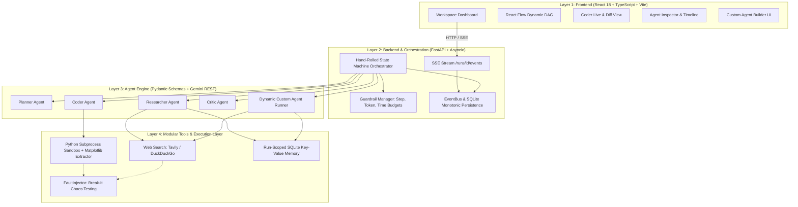

<div align="center">

# 🔍 AgentLens
### The Glass-Box Multi-Agent Orchestration & AI Observability Platform

**Build your own AI agent teams. Watch them collaborate. Understand, evaluate, and improve every execution.**

[-emerald?style=for-the-badge&logo=pytest)](backend/tests/)
[](https://python.org)
[](https://fastapi.tiangolo.com)
[](https://www.typescriptlang.org/)
[](https://react.dev)
[](LICENSE)

[Key Features](#-key-features) • [Quickstart (30s)](#-quickstart-in-30-seconds) • [Architecture](#-system-architecture) • [The 8 Core Concepts](#-the-8-core-architectural-concepts-why-panel) • [Coder Live & Diffs](#-coder-live--self-correction-diffs) • [Demo Script](DEMO_SCRIPT.md)

</div>

---

## 💡 The Core Problem: The Agent "Black Box"

Most agent frameworks (**LangChain**, **CrewAI**, **AutoGen**, **LangGraph**) operate as opaque black boxes. When agents stall, hallucinate, fail sandbox runs, or burn tokens in infinite loops, developers are left with cryptic tracebacks and no structured explanation.

**AgentLens replaces guesswork with total transparency.**

Every step in an AgentLens run produces a structured, monotonically sequenced, typed event stored in SQLite and streamed via Server-Sent Events (SSE) to a live DAG visualization interface.

```
Goal ──► [Planner] ──► [Task 1: Researcher] ──► [Task 2: Coder] ──► [Critic] ──► Complete Output
             │                 │                      │                ▲
             ▼                 ▼                      ▼                │
       Plan Created       Search Query           Subprocess &        Verdict:
        (JSON DAG)         (Tavily/DDG)           Plot Artifact      Accept / Retry
```

---

## ⚡ Key Features

| Capability | What It Does | Why It Matters |
|---|---|---|
| **Hand-Rolled State Machine** | Zero LangGraph / LangChain dependencies; ~300 lines of auditable Python state machine logic. | Complete deterministic control; no framework bloat or hidden prompt injections. |
| **Custom Agent Builder** | No-code UI to configure agents (instructions, models, allowed tools, schemas). | Extends the system dynamically; Planner immediately incorporates custom agents. |
| **Coder Live Panel** | Syntax-highlighted code, live stdout/stderr, and inline base64 matplotlib plots. | Real-time visibility into Python code execution and generated figures. |
| **Self-Correction Diff View** | Myers-style line diff between consecutive failed & corrected code attempts. | Visually proves whether agent self-healing actually improved the code. |
| **Break-It Chaos Engineering** | Inject intermittent tool faults (`timeout`, `empty`, `wrong_answer`, `garbage`). | Evaluates agent resilience and tests Critic retry loops under realistic stress. |
| **Code-Enforced Guardrails** | Hard programmatic limits on steps (25), tokens (60k), runtime (120s), tool timeouts (10s). | Prevents runaway billing loops in code, not just prompt requests. 80% warning alerts. |
| **Real-Time Financial Telemetry** | Exact per-step and run-level token counts, latency (ms), and cost tracking ($USD). | Complete financial observability down to fractions of a cent. |
| **Zero-Key Golden Runs** | 2 pre-seeded showcase runs committed in SQLite for instant offline replay. | Test and demo the platform immediately without needing an API key. |

---

## 🚀 Quickstart in 30 Seconds

### Option A: Run from the CLI (Instant Demo)

Run a complete multi-agent workflow directly in your terminal with colored live telemetry:

```bash
# Clone the repository
git clone https://github.com/tarunmavuri/AgentLens.git
cd AgentLens

# Install backend dependencies
pip install -r requirements.txt

# Execute a goal with the CLI orchestrator
python backend/run_goal.py "Benchmark three sorting algorithms on 10,000 items and explain the timings"
```

*Runs 100% offline out-of-the-box using the built-in simulation engine, generating 20+ observable events and a sandbox plot artifact.*

---

### Option B: Run Full-Stack Web Application

#### 1. Start the Backend API
```bash
# From project root
uvicorn backend.app.main:app --reload --port 8000
```
*API interactive documentation available at `http://localhost:8000/docs`*

#### 2. Start the Frontend UI
```bash
cd frontend
npm install
npm run dev
```
*Open `http://localhost:3000` to access the AgentLens workspace.*

---

## 🏛️ System Architecture



---

## ⚡ The 8 Core Architectural Concepts (Why? Panel)

AgentLens exposes an educational and architectural **"Why?"** panel mapping system behavior directly to core agentic design patterns:

| Concept | Architectural Implementation in AgentLens |
|---|---|
| **1. ReAct Pattern** | Agents alternate between internal reasoning (`thought`), environment action (`tool_call`), and observation (`tool_result`), adapting dynamically to unexpected outputs. |
| **2. Task Planning** | The **Planner Agent** parses unstructured user goals into an executable DAG of sub-tasks (max 5) with deterministic success criteria and explicit dependencies. |
| **3. Sandboxed Tool Use** | Tools are registered in a modular registry. The **Python Sandbox** runs code in isolated subprocesses with restricted imports (`subprocess`, `os.system` blocked), 10s timeouts, and 10 KB caps. |
| **4. Reflection & Retries** | The **Critic Agent** evaluates finished tasks against explicit criteria, assigns scores (0–10), and triggers automated feedback-directed retries (up to 2). |
| **5. Orchestration State Machine** | A handwritten async state machine manages agent handoffs, task lifecycle states, and SSE fan-out without external framework lock-in. |
| **6. Run-Scoped Memory** | Isolated key-value working memory allows downstream agents (e.g. Coder) to access research gathered by upstream agents (e.g. Researcher) without cross-run contamination. |
| **7. Code-Enforced Guardrails** | Budgets (max 25 steps, 60,000 tokens, 120 seconds) are checked programmatically on every state transition. Automatic warning events emit at 80% usage. |
| **8. Multi-Dimensional Eval** | Real-time telemetry records latency (ms), token volume, dollar cost, Critic scores, and tool error rates to quantify execution efficiency. |

---

## 💻 Coder Live & Self-Correction Diffs

When programming tasks run, the **Coder Agent** executes scripts inside an isolated Python subprocess sandbox.

If an execution fails (syntax error, runtime error, or failing assertion), the Coder analyzes the stderr and attempts an automated fix (up to 3 attempts).

### The CoderLive Panel (`CoderLive.tsx`) provides:
1. **Split-Screen Execution:** Code script on the left, execution terminal (stdout/stderr) and latency on the right.
2. **Inline Plot Rendering:** Headless matplotlib figures are captured directly from memory, converted to base64 PNGs, and rendered as inline `artifact` events.
3. **Myers-Style Diff View:** Toggle the **Diff View** tab to inspect a colored line-by-line comparison between consecutive attempts:
   - <span style="color:#ef4444">**Red (-)**</span>: Faulty or buggy code lines removed.
   - <span style="color:#10b981">**Green (+)**</span>: Corrected lines introduced during self-correction.

---

## 🛠️ The Agent Suite

### 1. Planner Agent
- Interprets user goal and decomposes it into smaller sequential tasks.
- Supports dynamic registration: assigns tasks to built-in agents OR registered custom agents.
- Defines deterministic success criteria for each task.

### 2. Researcher Agent
- Formulates optimized search queries.
- Primary provider: **Tavily Search API**; Fallback: **DuckDuckGo**.
- Summarizes findings, extracts citations, and writes key data to run-scoped memory.

### 3. Coder Agent
- Writes Python code to fulfill technical requirements and benchmarks.
- Runs inside isolated subprocesses with execution timeout and import safety checks.
- Generates data visualizations with matplotlib and emits base64 `artifact` events.
- Performs up to 3 fix attempts upon execution failure.

### 4. Critic Agent
- Evaluates task output against initial success criteria.
- Scores execution quality from 0 to 10.
- Issues verdicts: `accept` or `retry` (max 2 retries per task) with structured diagnostic guidance.

### 5. Custom Agent Engine
- Users can create new agents in the **Custom Agent Builder**.
- Configurable role, system instructions, model, tool permissions, and execution limits.
- Evaluated and scored by the Critic exactly like built-in agents.

---

## 📊 Comprehensive Test Suite

AgentLens includes a full test suite verifying every component from sandbox security to end-to-end chaos orchestration:

```bash
python -m pytest backend/tests -v
```

```text
backend/tests/test_agents.py::test_registry_built_in_agents PASSED         [ 5%]
backend/tests/test_agents.py::test_custom_agent_crud PASSED                [10%]
backend/tests/test_agents.py::test_cannot_delete_builtin_agent PASSED      [15%]
backend/tests/test_api.py::test_health_check PASSED                        [21%]
backend/tests/test_api.py::test_concepts PASSED                            [26%]
backend/tests/test_api.py::test_list_runs_and_golden_runs PASSED           [31%]
backend/tests/test_api.py::test_create_and_get_run PASSED                  [36%]
backend/tests/test_api.py::test_export_trace PASSED                        [42%]
backend/tests/test_api.py::test_agents_crud_and_test PASSED                [47%]
backend/tests/test_api.py::test_tools_endpoints PASSED                     [52%]
backend/tests/test_orchestrator.py::test_orchestrator_end_to_end PASSED    [57%]
backend/tests/test_orchestrator.py::test_orchestrator_with_chaos PASSED    [63%]
backend/tests/test_tools.py::test_sandbox_execution PASSED                 [68%]
backend/tests/test_tools.py::test_sandbox_security PASSED                  [73%]
backend/tests/test_tools.py::test_sandbox_timeout PASSED                   [78%]
backend/tests/test_tools.py::test_sandbox_matplotlib_artifact PASSED       [84%]
backend/tests/test_tools.py::test_web_search PASSED                        [89%]
backend/tests/test_tools.py::test_run_memory PASSED                        [94%]
backend/tests/test_tools.py::test_fault_injection PASSED                   [100%]
============================== 19 passed in 35.9s ==============================
```

---

## 📡 REST API Reference

| Method | Endpoint | Description |
|---|---|---|
| `POST` | `/api/runs` | Create and trigger a new agent execution run |
| `GET` | `/api/runs` | List all historical and golden runs |
| `GET` | `/api/runs/{id}` | Get run summary, status, and financial totals |
| `GET` | `/api/runs/{id}/events` | Connect to live Server-Sent Events (SSE) event stream |
| `GET` | `/api/runs/{id}/trace` | Download full deterministic run replay JSON |
| `GET` | `/api/agents` | List all built-in and active custom agents |
| `POST` | `/api/agents` | Register a new custom agent |
| `DELETE`| `/api/agents/{id}` | Delete a custom agent (built-in agents are protected) |
| `POST` | `/api/agents/{id}/test` | Execute an isolated sandbox test of a custom agent |
| `GET` | `/api/tools` | Discover available tools, parameters, and categories |
| `GET` | `/api/concepts` | Retrieve educational explanations of the 8 core concepts |

---

## 🎬 60-Second Demo Video Walkthrough

Looking to record or inspect a demo of AgentLens? See the complete step-by-step click-path script in [DEMO_SCRIPT.md](DEMO_SCRIPT.md).

---

## 📄 License

Distributed under the **MIT License**. Free for academic, personal, and commercial engineering use.
